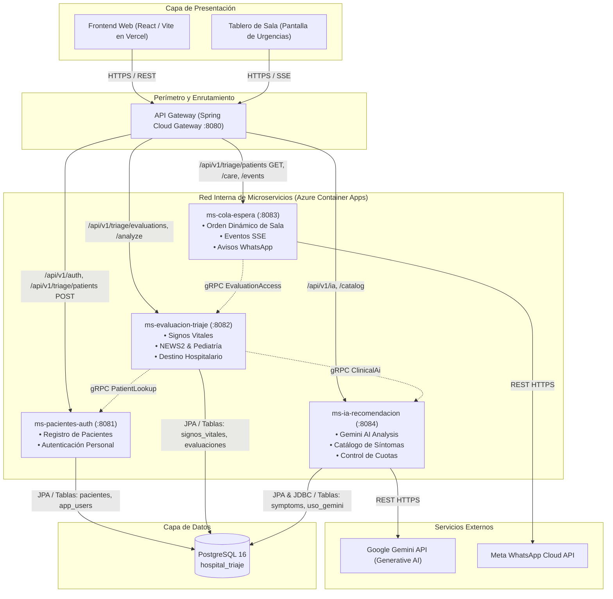

# Arquitectura Global de Microservicios — TriageIA

## 1. Visión General
**TriageIA** es un sistema hospitalario distribuido para la recepción, evaluación clínica, estratificación del riesgo mediante reglas de triaje (NEWS2, rangos pediátricos, códigos obstétricos) y gestión de salas de espera con apoyo opcional de Inteligencia Artificial (Google Gemini).

El sistema sigue una arquitectura orientada a microservicios desacoplados con:
- **API Gateway:** Punto único de entrada exterior para clientes web (React en Vercel) y observabilidad.
- **Microservicios de Dominio:** Procesos autónomos en Spring Boot ejecutados en contenedores Docker independientes.
- **Comunicación Interna:** gRPC con Protocol Buffers sobre HTTP/2 para máxima velocidad y tipado estricto.
- **Comunicación Externa:** REST API sobre JSON y Server-Sent Events (SSE) para actualizaciones en vivo.
- **Persistencia:** PostgreSQL compartido con segregación lógica de propiedad de tablas por microservicio.
- **Despliegue Cloud:** Microsoft Azure (Azure Container Apps, Azure Container Registry, Azure Key Vault).

---

## 2. Diagrama de Arquitectura Global

---

## 3. Principios de Diseño
1. **Desacoplamiento Estricto:** Ningún microservicio comparte entidades JPA o tablas directamente con otro microservicio. La comunicación entre dominios se realiza exclusivamente a través de contratos gRPC o HTTP.
2. **Resiliencia y Fallback:** Si el microservicio de IA no responde o se agotan las cuotas de Gemini, `ms-evaluacion-triaje` continúa funcionando autónomamente con el protocolo clínico sin interrumpir la atención.
3. **Observabilidad Distribuida:** El API Gateway inyecta un encabezado `X-Correlation-Id` en cada solicitud para permitir el rastreo de punta a punta en los logs de Azure Monitor / Application Insights.

