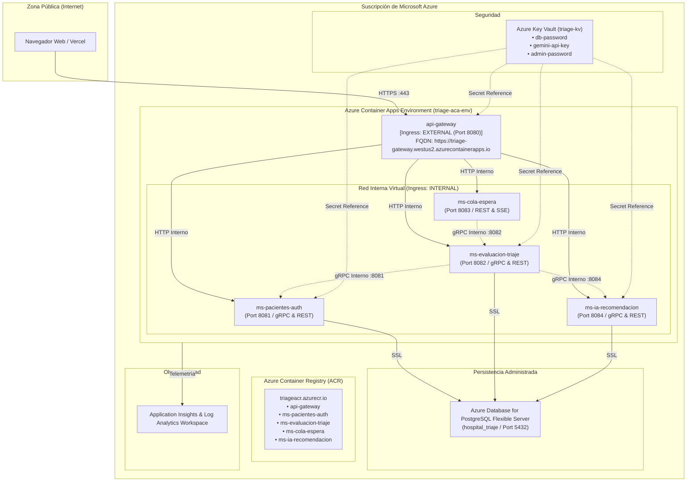

# Arquitectura de Despliegue en Microsoft Azure — TriageIA

## 1. Topología Cloud en Azure

---

## 2. Componentes y Funciones
1. **Azure Container Registry (ACR):** Almacén seguro y privado de imágenes Docker multi-stage construidas por GitHub Actions.
2. **Azure Container Apps (ACA):** Aloja las cinco aplicaciones como contenedores serverless con autoscaling (0 a 1 réplica en modo de bajo costo).
3. **Azure Database for PostgreSQL Flexible Server:** Base de datos PostgreSQL relacional administrada con copias de seguridad automáticas y alta disponibilidad.
4. **Azure Key Vault:** Gestión segura de secretos y cadenas de conexión sin exponerlas en repositorios.
5. **Azure Monitor / Application Insights:** Trazabilidad de logs y diagnósticos de salud distribuidos.

