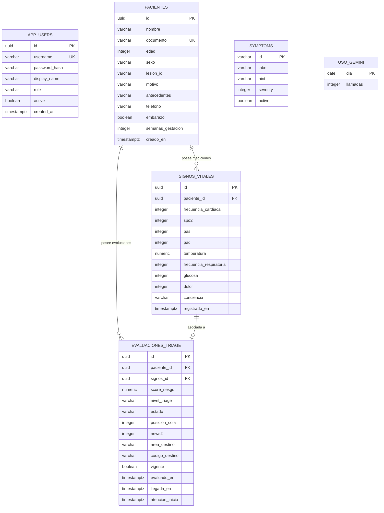

# Modelo de Datos y Esquema Relacional PostgreSQL — TriageIA

## 1. Instancia y Propiedad de Datos
Base de datos: `hospital_triaje` (PostgreSQL 16).
La arquitectura utiliza un modelo de persistencia compartida con segregación de propiedad estricta por microservicio:

| Microservicio | Tablas Propiedad Exclusiva | Propósito |
|---|---|---|
| `ms-pacientes-auth` | `pacientes`, `app_users` | Datos demográficos y personal autorizado. |
| `ms-evaluacion-triaje` | `signos_vitales`, `evaluaciones_triage` | Constantes fisiológicas y clasificaciones. |
| `ms-ia-recomendacion` | `symptoms`, `uso_gemini` | Catálogo de síntomas y control de cuota de IA. |
| `ms-cola-espera` | *(Ninguna)* | Servicio orquestador en memoria. |

---

## 2. Diagrama Entidad-Relación Lógico

---

## 3. Secuencia de Scripts SQL de Inicialización
En el proyecto `Triage_base-de-datos/sql/`:
1. `01_schema.sql`: Estructura base de pacientes, signos vitales y evaluaciones.
2. `02_catalogo.sql`: Referencia de catálogo legacy.
3. `03_triaje_ampliado.sql`: Ajustes de signos vitales (glucosa, dolor, conciencia AVPU) y destinos.
4. `04_historial_avisos.sql`: Soporte para reevaluaciones, llamadas a Gemini y campos obstétricos.
5. `05_usuarios_y_sintomas.sql`: DDL formal para `app_users` y catálogo unificado de `symptoms`.

